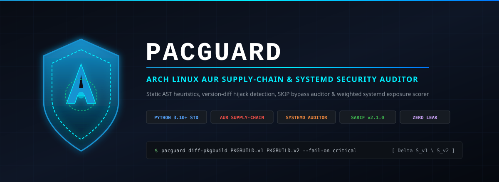
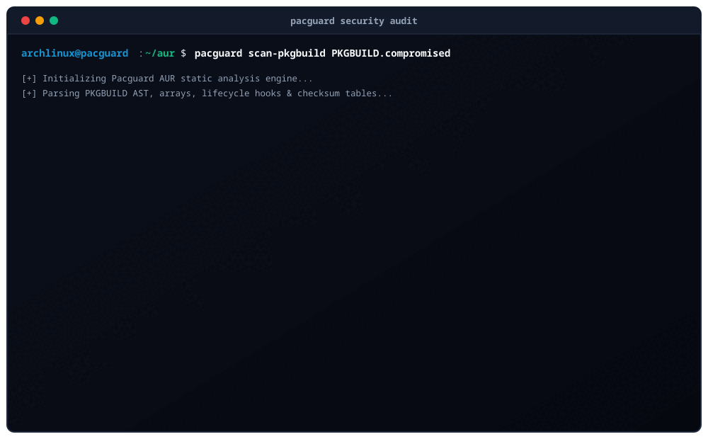
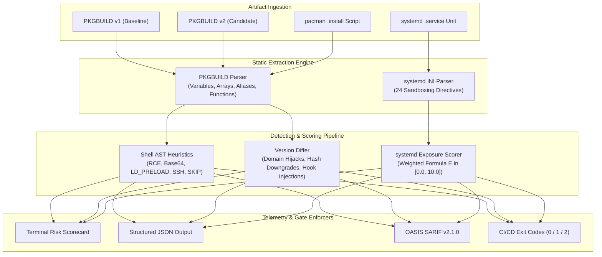

# Pacguard — Arch Linux AUR Supply-Chain Security & systemd Hardening Auditor

**DevSecOps & Supply-Chain Security Engine for PKGBUILD Recipe Forensics, Version-Diff Hijack Detection, and Weighted systemd Sandboxing Verification**



`Pacguard` is a zero-dependency, pure Python 3.10+ security analysis engine engineered for Arch Linux systems, package maintainers, enterprise DevOps pipelines, and security incident-response teams. It performs static abstract syntax tree (AST) and token-level forensic auditing on Arch User Repository (AUR) `PKGBUILD` scripts and `.install` lifecycle hooks, discovers version-to-version upstream domain hijacks and checksum bypasses (`SKIP`), and audits `systemd` `.service` units against 24 security directives computing a mathematically normalized Exposure Score $E \in [0.0, 10.0]$ modeled after `systemd-analyze security`.



---

## Table of Contents

1. [Architectural Overview](#1-architectural-overview)
2. [Mathematical Foundations](#2-mathematical-foundations)
   - [2.1 systemd Weighted Security Exposure Scoring](#21-systemd-weighted-security-exposure-scoring)
   - [2.2 Differential Version-to-Version Threat Metrics](#22-differential-version-to-version-threat-metrics)
3. [MITRE ATT&CK v15 Taxonomy Matrix](#3-mitre-attck-v15-taxonomy-matrix)
4. [AUR Forensic Rule Engine](#4-aur-forensic-rule-engine)
   - [4.1 Malicious Shell Patterns & Exploitation Heuristics](#41-malicious-shell-patterns--exploitation-heuristics)
   - [4.2 Differential Supply-Chain Regression Rules](#42-differential-supply-chain-regression-rules)
5. [systemd 24-Directive Sandboxing Matrix](#5-systemd-24-directive-sandboxing-matrix)
6. [CLI Command Reference](#6-cli-command-reference)
   - [6.1 scan-pkgbuild](#61-scan-pkgbuild)
   - [6.2 diff-pkgbuild](#62-diff-pkgbuild)
   - [6.3 audit-systemd](#63-audit-systemd)
   - [6.4 export-sarif](#64-export-sarif)
7. [OASIS SARIF v2.1.0 & DevSecOps CI/CD Integration](#7-oasis-sarif-v210--devsecops-cicd-integration)
8. [Automated Verification & Zero-Leak Security Gate](#8-automated-verification--zero-leak-security-gate)
9. [Author & License](#9-author--license)

---

## 1. Architectural Overview

Arch Linux PKGBUILD files are executable Bash scripts interpreted directly by `makepkg`. While `makepkg` supports running builds in isolated chroots (`makechrootpkg`), build hooks (`prepare()`, `build()`, `package()`) execute arbitrary shell code. Furthermore, accompanying `.install` scripts (`post_install()`, `post_upgrade()`) execute with unrestricted `root` privileges during package installation via `pacman -U`.

Pacguard operates as a multi-stage static analysis pipeline:



### Component Architecture

- **`pacguard/pkgbuild_parser.py`**: Tokenizes Bash variable assignments, single and multi-line arrays (`source`, `sha256sums`, `depends`, `makedepends`), variable parameter expansions (`${pkgname}`, `${pkgver}`), and extracts function blocks with brace-depth tracking.
- **`pacguard/shell_heuristics.py`**: Scans lifecycle function bodies and global lines against supply-chain exploit patterns, credential interception sinks, and reverse shell sockets.
- **`pacguard/pkgbuild_diff.py`**: Calculates the threat delta between two package versions, isolating source domain switches, hash downgrades, and newly introduced hooks.
- **`pacguard/systemd_scorer.py`**: Audits unit files against 24 security directives, assigning weights and computing the exposure score.
- **`pacguard/sarif.py`**: Generates OASIS SARIF v2.1.0 JSON documents compatible with GitHub Advanced Security and terminal scorecards.
- **`pacguard/cli.py`**: Unified entrypoint supporting `scan-pkgbuild`, `diff-pkgbuild`, `audit-systemd`, and `export-sarif`.

---

## 2. Mathematical Foundations

### 2.1 systemd Weighted Security Exposure Scoring

The exposure scoring engine models Linux systemd unit exposure mathematically. Let $D = \{d_1, d_2, \dots, d_{24}\}$ represent the set of 24 evaluated security directives. Each directive $d_i$ is parameterized by a fixed weight $W_i > 0$ and an exposure factor $\phi_i \in [0.0, 1.0]$:

$$\phi_i = \begin{cases}
0.0 & \text{if directive is fully hardened and active} \\
\lambda_i & \text{if directive is partially configured } (0.0 < \lambda_i < 1.0) \\
1.0 & \text{if directive is disabled, unset, or default unhardened}
\end{cases}$$

The total systemd Exposure Score $E$ is normalized over a continuous interval $[0.0, 10.0]$:

$$E = 10.0 \times \frac{\sum_{i=1}^{24} W_i \cdot \phi_i}{\sum_{i=1}^{24} W_i}$$

#### Exposure Rating Classification

$$\text{Rating}(E) = \begin{cases}
\text{SAFE (Hardened)} & \text{if } 0.0 \le E \le 3.3 \\
\text{MEDIUM (Partial Sandboxing)} & \text{if } 3.4 \le E \le 6.6 \\
\text{EXPOSED (Dangerous / Unhardened)} & \text{if } 6.7 \le E \le 10.0
\end{cases}$$

When all 24 directives are configured with strict sandboxing (e.g. `ProtectSystem=strict`, `DynamicUser=yes`, `NoNewPrivileges=yes`), $\phi_i = 0.0 \implies E = 0.0$. Conversely, an unhardened service running as `root` with no namespace limits yields $\phi_i = 1.0 \implies E = 10.0$.

### 2.2 Differential Version-to-Version Threat Metrics

When an AUR package maintainer updates a package from version $V_1$ to $V_2$, Pacguard computes the differential security distance $\Delta(V_1, V_2)$. Given source URL sets $S(V_1)$ and $S(V_2)$, domain mapping function $\text{Dom}(s)$, and checksum mapping $\text{Hash}(s)$:

$$\text{DomainAnomaly}(s_i) = \begin{cases}
1 & \text{if } \text{Dom}(s_i^{(V_1)}) \ne \text{Dom}(s_i^{(V_2)}) \land \text{IsRemote}(s_i) \\
0 & \text{otherwise}
\end{cases}$$

$$\text{HashDowngrade}(s_i) = \begin{cases}
1 & \text{if } \text{Hash}(s_i^{(V_1)}) \ne \text{'SKIP'} \land \text{Hash}(s_i^{(V_2)}) = \text{'SKIP'} \\
0 & \text{otherwise}
\end{cases}$$

Any package update exhibiting $\text{DomainAnomaly} = 1$ or $\text{HashDowngrade} = 1$ immediately generates a `CRITICAL` supply-chain rejection.

---

## 3. MITRE ATT&CK v15 Taxonomy Matrix

Pacguard maps all detected anomalies and insecure configurations directly to the MITRE ATT&CK enterprise matrix:

| Technique ID | Technique Name | Tactic | Pacguard Rule ID |
| :--- | :--- | :--- | :--- |
| **T1195.002** | Supply Chain Compromise: Compromise Software Supply Chain | Initial Access | `PG005_SKIP_CHECKSUM_NON_VCS`, `PG_DIFF_URL_HIJACK`, `PG_DIFF_CHECKSUM_DOWNGRADE` |
| **T1059.004** | Command and Scripting Interpreter: Unix Shell | Execution | `PG001_NETWORK_EXEC_PIPE`, `PG007_INSTALL_HOOK_NETWORK_FETCH` |
| **T1027** | Obfuscated Files or Information | Defense Evasion | `PG002_OBFUSCATED_PAYLOAD_EVAL` |
| **T1574.006** | Hijack Execution Flow: Dynamic Linker Hijacking | Persistence / Privilege Escalation | `PG003_LD_PRELOAD_TAMPERING` |
| **T1552.004** | Unsecured Credentials: Private Keys | Credential Access | `PG004_CREDENTIAL_EXFILTRATION` |
| **T1053.003** | Scheduled Task/Job: Cron | Persistence / Privilege Escalation | `PG006_PERSISTENCE_TAMPERING` |
| **T1543.002** | Create or Modify System Process: systemd Service | Persistence / Privilege Escalation | `SD_EXPOSURE_RISK` |
| **T1546** | Event Triggered Execution | Persistence / Privilege Escalation | `PG007_INSTALL_HOOK_NETWORK_FETCH` |

---

## 4. AUR Forensic Rule Engine

### 4.1 Malicious Shell Patterns & Exploitation Heuristics

| Rule ID | Severity | Target Context | Detection Logic | Description |
| :--- | :--- | :--- | :--- | :--- |
| **`PG001_NETWORK_EXEC_PIPE`** | `CRITICAL` | Lifecycle hooks | `curl\|sh`, `wget\|bash`, `eval "$(curl ...)"` | Unverified remote script directly piped into shell interpreter. |
| **`PG002_OBFUSCATED_PAYLOAD_EVAL`** | `CRITICAL` | Any function / global | `base64 -d \| sh`, `eval $(echo ... \| base64)` | Obfuscated Base64 or binary payload execution. |
| **`PG003_LD_PRELOAD_TAMPERING`** | `CRITICAL` | Any function / global | `LD_PRELOAD=...`, `/etc/ld.so.preload` | Dynamic linker interception and userland rootkit staging. |
| **`PG004_CREDENTIAL_EXFILTRATION`** | `CRITICAL` | Any function / global | `~/.ssh/id_*`, `/etc/shadow`, `~/.aws` | Direct access to host identity and cryptographic secrets. |
| **`PG005_SKIP_CHECKSUM_NON_VCS`** | `HIGH` | `source` + checksums | Non-VCS archive with `sha256sums=('SKIP')` | Integrity verification bypassed on static remote download. |
| **`PG006_PERSISTENCE_TAMPERING`** | `HIGH` | Any function / global | `/etc/cron.*`, `/etc/sudoers`, `autostart` | Unauthorized system persistence injection outside package directory. |
| **`PG007_INSTALL_HOOK_NETWORK_FETCH`** | `CRITICAL` | `.install` hooks | `curl`, `wget`, `nc` in `post_install()` | Network request executed as root during `pacman -U` installation. |
| **`PG008_REVERSE_SHELL_SOCKET`** | `CRITICAL` | Any function / global | `/dev/tcp/*`, `nc -e`, `socket.connect()` | Outbound reverse shell or raw network socket callback. |
| **`PG009_INSECURE_HTTP_FETCH`** | `MEDIUM` | `source` array | `http://...`, `ftp://...` | Plaintext protocol vulnerable to active MITM tampering. |
| **`PG010_DEPRECATED_HASH_ALGORITHM`** | `LOW` | Checksum arrays | `md5sums`, `sha1sums` | Obsolete hash algorithms vulnerable to collision attacks. |

### 4.2 Differential Supply-Chain Regression Rules

| Rule ID | Severity | Anomaly Description |
| :--- | :--- | :--- |
| **`PG_DIFF_URL_HIJACK`** | `CRITICAL` | Source download domain swapped between revisions (e.g. `github.com` to `githvb.com`). |
| **`PG_DIFF_CHECKSUM_DOWNGRADE`** | `CRITICAL` | Valid cryptographic hash in v1 downgraded to `SKIP` in v2. |
| **`PG_DIFF_PROJECT_URL_CHANGED`** | `HIGH` | Upstream project homepage URL modified. |
| **`PG_DIFF_DEPENDS_INJECTION`** | `HIGH` | New unverified runtime dependencies added to `depends`. |
| **`PG_DIFF_HOOK_INJECTION`** | `HIGH` | Lifecycle hook function introduced (e.g. new `prepare()` function). |
| **`PG_DIFF_INSTALL_SCRIPT_ADDED`** | `HIGH` | Package gained pacman `.install` script executing root hooks. |

---

## 5. systemd 24-Directive Sandboxing Matrix

Pacguard audits systemd service units across 24 core capabilities, evaluating sandboxing isolation:

| # | Directive Name | Weight $W_i$ | Hardened Criteria | Failure Recommendation |
| :---: | :--- | :---: | :--- | :--- |
| 1 | `User` | 0.8 | Non-root dedicated user or `DynamicUser=yes` | Set `User=` to dedicated unprivileged service account. |
| 2 | `DynamicUser` | 0.6 | `DynamicUser=yes` | Set `DynamicUser=yes` for ephemeral UID/GID isolation. |
| 3 | `ProtectSystem` | 0.7 | `ProtectSystem=strict` (or `full`) | Set `ProtectSystem=strict` to enforce read-only OS filesystem. |
| 4 | `ProtectHome` | 0.7 | `ProtectHome=yes` or `strict` | Set `ProtectHome=yes` to hide `/home`, `/root`, `/run/user`. |
| 5 | `NoNewPrivileges` | 0.6 | `NoNewPrivileges=yes` | Set `NoNewPrivileges=yes` to block setuid elevation. |
| 6 | `CapabilityBoundingSet` | 0.6 | Empty or drops `CAP_SYS_ADMIN` | Set `CapabilityBoundingSet=` to drop all Linux capabilities. |
| 7 | `AmbientCapabilities` | 0.4 | Empty or unset | Do not configure `AmbientCapabilities=` unless necessary. |
| 8 | `MemoryDenyWriteExecute` | 0.6 | `MemoryDenyWriteExecute=yes` | Set `MemoryDenyWriteExecute=yes` to prevent W^X violations. |
| 9 | `PrivateTmp` | 0.5 | `PrivateTmp=yes` | Set `PrivateTmp=yes` for isolated per-unit `/tmp` namespace. |
| 10 | `PrivateDevices` | 0.5 | `PrivateDevices=yes` | Set `PrivateDevices=yes` to block physical hardware device access. |
| 11 | `PrivateNetwork` | 0.5 | `PrivateNetwork=yes` | Set `PrivateNetwork=yes` to isolate network namespace. |
| 12 | `ProtectKernelTunables` | 0.5 | `ProtectKernelTunables=yes` | Set `ProtectKernelTunables=yes` to make `/proc/sys` read-only. |
| 13 | `ProtectKernelModules` | 0.5 | `ProtectKernelModules=yes` | Set `ProtectKernelModules=yes` to forbid kernel module loading. |
| 14 | `ProtectKernelLogs` | 0.4 | `ProtectKernelLogs=yes` | Set `ProtectKernelLogs=yes` to block `dmesg` ring buffer access. |
| 15 | `ProtectControlGroups` | 0.5 | `ProtectControlGroups=yes` | Set `ProtectControlGroups=yes` to prevent cgroup modifications. |
| 16 | `ProtectClock` | 0.4 | `ProtectClock=yes` | Set `ProtectClock=yes` to prevent system clock alterations. |
| 17 | `ProtectHostname` | 0.4 | `ProtectHostname=yes` | Set `ProtectHostname=yes` to isolate UTS namespace. |
| 18 | `RestrictRealtime` | 0.4 | `RestrictRealtime=yes` | Set `RestrictRealtime=yes` to prevent realtime CPU starvation. |
| 19 | `RestrictNamespaces` | 0.5 | `RestrictNamespaces=yes` | Set `RestrictNamespaces=yes` to block namespace creation. |
| 20 | `RestrictAddressFamilies`| 0.5 | Explicit list (e.g. `AF_UNIX AF_INET`) | Restrict socket families to required protocols. |
| 21 | `LockPersonality` | 0.4 | `LockPersonality=yes` | Set `LockPersonality=yes` to prevent 32-bit execution mode switches. |
| 22 | `SystemCallFilter` | 0.6 | `@system-service` or whitelist | Set `SystemCallFilter=@system-service` for seccomp filtering. |
| 23 | `SystemCallArchitectures`| 0.4 | `SystemCallArchitectures=native` | Set `SystemCallArchitectures=native` to block cross-ABI syscalls. |
| 24 | `RemoveIPC` | 0.4 | `RemoveIPC=yes` | Set `RemoveIPC=yes` to clean up POSIX/SysV IPC upon termination. |

---

## 6. CLI Command Reference

### 6.1 scan-pkgbuild

Inspect a PKGBUILD recipe and optional pacman `.install` script:

```bash
# Basic terminal scan with colored scorecard
pacguard scan-pkgbuild PKGBUILD

# Scan with explicit .install script and fail if critical findings exist
pacguard scan-pkgbuild PKGBUILD --install-script package.install --fail-on critical

# Output findings in JSON format
pacguard scan-pkgbuild PKGBUILD --format json --output report.json

# Generate SARIF v2.1.0 document
pacguard scan-pkgbuild PKGBUILD --format sarif --output pacguard.sarif
```

### 6.2 diff-pkgbuild

Compare two PKGBUILD revisions to detect supply-chain regressions:

```bash
# Compare upstream baseline v1 against candidate v2
pacguard diff-pkgbuild PKGBUILD.v1 PKGBUILD.v2

# Fail in CI pipeline if domain hijack or checksum downgrade occurs
pacguard diff-pkgbuild PKGBUILD.v1 PKGBUILD.v2 --fail-on critical
```

### 6.3 audit-systemd

Audit a systemd `.service` file and calculate the exposure score:

```bash
# Audit unit and print 24-directive scorecard
pacguard audit-systemd /usr/lib/systemd/system/app.service

# Enforce hardening gate (fail if exposure score exceeds 4.0)
pacguard audit-systemd app.service --fail-on-score 4.0
```

### 6.4 export-sarif

Directly export OASIS SARIF v2.1.0 telemetry:

```bash
pacguard export-sarif --pkgbuild PKGBUILD --systemd app.service --output security-report.sarif
```

---

## 7. OASIS SARIF v2.1.0 & DevSecOps CI/CD Integration

Pacguard produces OASIS SARIF v2.1.0 compliant JSON. To automate AUR and systemd audits in GitHub Actions:

```yaml
name: Security Audit Gate

on:
  push:
    branches: [ main ]
  pull_request:
    branches: [ main ]

jobs:
  pacguard-audit:
    runs-on: ubuntu-latest
    steps:
      - name: Checkout Repository
        uses: actions/checkout@v4

      - name: Set up Python
        uses: actions/setup-python@v5
        with:
          python-version: "3.11"

      - name: Install Pacguard
        run: pip install .

      - name: Run PKGBUILD Security Scan
        run: |
          pacguard scan-pkgbuild PKGBUILD --format sarif --output pacguard-results.sarif --fail-on high

      - name: Upload SARIF to GitHub Code Scanning
        if: always()
        uses: github/codeql-action/upload-sarif@v3
        with:
          sarif_file: pacguard-results.sarif
```

---

## 8. Automated Verification & Zero-Leak Security Gate

Pacguard enforces strict DevSecOps and zero-leak engineering standards:

```bash
# Run unit test suite (24 rootless unit & integration tests)
python3 -m unittest discover -s tests -v

# Run zero-leak verification gate
bash scripts/security-audit.sh
```

### Verification Checks Enforced

1. **Path Leak Check**: Verifies zero machine-specific filesystem paths (`/home/<user>`, `/Users/<user>`).
2. **Username Leak Check**: Asserts zero current OS username occurrences across repository files.
3. **Hostname Leak Check**: Asserts zero workstation hostname occurrences across repository files.
4. **Credential Audit**: Verifies zero hardcoded private keys or tokens.
5. **Emoji Gate**: Validates zero Unicode emoji symbols across all project assets, comments, and documentation.
6. **Git Identity**: Confirms commit author is `1MEshh <152591660+1MEshh@users.noreply.github.com>`.
7. **Test Pass Rate**: Enforces 100% pass on all 24 unit and integration tests.

---

## 9. Author & License

- **Author**: `1MEshh` (`152591660+1MEshh@users.noreply.github.com`)
- **Repository**: [https://github.com/1MEshh/Pacguard](https://github.com/1MEshh/Pacguard)
- **License**: MIT Open Source License
